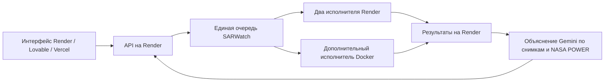

# Размещение SARWatch на Render

Конфигурация создаёт **один Docker Web Service с планом `free`**. Он отдаёт интерфейс, подготовленные кейсы и API по одному HTTPS-адресу. Отдельные платные базы данных, диски, workers и второй сервис не создаются. Публичный адрес появится после фактического развёртывания; эти файлы сами по себе ничего не публикуют.

## Что входит в образ

- Интерфейс собирается в `node:24-bookworm-slim` с `pnpm@11.25.0` и `pnpm-lock.yaml`.
- API работает в `python:3.12-slim-bookworm`; `pip install '.[web]'` использует версии из `requirements.lock.txt`. Для сторонних Python-пакетов требуются готовые wheels.
- Подготовленные материалы копируются из `cases/`; шрифты и их лицензии входят в пакет `sarwatch`.
- Исходные HDF5/GeoTIFF, `.env`, токены, `.venv`, `node_modules`, временные задания и локальные результаты исключены из Docker context. Node и менеджер пакетов отсутствуют в конечном образе.
- Процесс работает от непривилегированного пользователя. Один `uvicorn` worker сохраняет ограничение «один расчёт одновременно».

Earthdata Token вводится **только в настройках сервиса Render**, не в Dockerfile, аргументах сборки, репозитории или браузерном интерфейсе. В `render.yaml` у него указано `sync: false`. Render использует это поле для запроса значения при создании Blueprint. [Документация Blueprint](https://render.com/docs/blueprint-spec), [секреты среды](https://render.com/docs/configure-environment-variables).

Поддерживаются два вида репозитория: обычные распакованные исходники и корневой `sarwatch-source.zip` рядом с `Dockerfile` и `render.yaml`. Во втором случае первая стадия распаковывает ZIP и проверяет структуру. ZIP должен содержать `frontend/`, `sarwatch/`, `cases/`, `pyproject.toml`, `requirements.lock.txt` непосредственно в корне. Проверка сборки отвергает `.env`, `.env.*`, `.git`, `.venv`, `node_modules` и другие локальные каталоги внутри ZIP; `.dockerignore` не может удалить файлы из уже готового архива. Используйте только подготовленный архив исходников без секретов.

## Развёртывание

1. Разместите исходники проекта в GitHub-репозитории, сохранив `Dockerfile`, `.dockerignore`, `render.yaml`, `requirements.lock.txt`, `frontend/pnpm-lock.yaml`, каталог `sarwatch/` и все подготовленные `cases/`. Альтернатива для загрузки через браузер: `sarwatch-source.zip` с указанной структурой плюс корневые `Dockerfile`, `.dockerignore` и `render.yaml`.
2. В Render выберите **New → Blueprint**, подключите этот репозиторий и используйте корневой `render.yaml`.
3. В форме задайте `EARTHDATA_TOKEN` из Earthdata. Для просмотра подготовленных кейсов и поиска метаданных он не требуется; для новых расчётов нужен действующий токен с доступом к NISAR/ASF.
4. Убедитесь, что создаётся только `sarwatch`, тип Web Service, runtime Docker, план **Free**. Примените Blueprint.
5. Дождитесь успешной сборки и состояния Live. Откройте выданный Render HTTPS-адрес, а не HTML-файл из репозитория.

Render передаёт порт через `PORT`; команда запуска использует `--host 0.0.0.0 --port ${PORT:-8000} --workers 1`. Проверка здоровья обращается к `/api/health`. Формат этих настроек соответствует [Blueprint specification](https://render.com/docs/blueprint-spec) и [health checks](https://render.com/docs/health-checks).

## Проверка после публикации

На `/api/health` ожидаются `application: "sarwatch"`, `status: "ok"` и `data_access_configured: true` для новых расчётов NISAR. Проверьте главную страницу, EN/RU/KK, отчёты, переключение дат и два новых одновременных расчёта.

Интерфейс использует относительные `/api/...` и `/cases/...`; `VITE_API_URL` при такой схеме не задаётся. Настройка CORS для отдельного домена не нужна. Не заменяйте запуск на `sarwatch.serve`: этот модуль предназначен для локального открытия браузера, а контейнер запускает непосредственно API.

## Ограничения бесплатного сервиса

По состоянию на 13 ноября 2026 Render усыпляет Free Web Service после 15 минут простоя; следующий запрос запускает его примерно за минуту. Локальные задания теряются при перезапуске, обновлении и засыпании. Подготовленные кейсы остаются в образе. На рабочее пространство выделяется 750 бесплатных instance-hours в месяц; действуют отдельные лимиты трафика и сборок. Это ограничения хостинга для демонстрации, а не ошибки приложения. [Текущие условия Free](https://render.com/docs/free).

Бюджет чтения данных составляет **600 000 000 байт и 900 секунд на пару**. `SARWATCH_HEAVY_WORKERS=2` запускает два расчёта NISAR/Landsat параллельно. Два слота MODIS работают независимо. `SARWATCH_QUEUE_LIMIT` задаёт число ожидающих заданий в каждой очереди.

NASA POWER доступен без ключа. Для Gemini создайте ключ в [Google AI Studio](https://aistudio.google.com/apikey). В Render откройте **SARWatch → Environment → Add Environment Variable**. В поле **Key** укажите `GEMINI_API_KEY`, в поле **Value** вставьте ключ, затем выберите **Save and deploy**. В `/api/health` поле `ai_configured` показывает, доступен ли серверу ключ. В разделе погоды готового примера можно проверить, вернул ли провайдер объяснение. По умолчанию используется `gemini-3.5-flash-lite`. Gemini получает спутниковые миниатюры, измерения и погодные показатели NASA POWER. Для текстовых объяснений OpenAI поддерживается `OPENAI_API_KEY`.

Если ключ хранится в Environment Group `gemini`, в настройках сервиса откройте **Environment → Linked Environment Groups → Link** и выберите `gemini`. Render запустит деплой. Переменная с тем же именем в настройках сервиса имеет приоритет над группой. [Документация Render](https://render.com/docs/configure-environment-variables#linking-a-group-to-a-service)

## Render, Lovable и дополнительный исполнитель



Для Lovable создайте `release/sarwatch-lovable.zip` командой `python scripts/build_lovable.py`. В Lovable выберите **Import project → Upload code**. В ZIP уже указан публичный API Render. Для Vercel используйте тот же клиент или соберите `frontend` с `VITE_API_URL=https://sarwatch-space-apps-2026.onrender.com`. Добавьте точные origin предпросмотра и опубликованного интерфейса в `CORS_ORIGINS` на Render через запятую. Интерфейс получает примеры, спутниковые снимки, погоду и отчёты через один API. [Импорт ZIP в Lovable](https://docs.lovable.dev/features/projects/import-project)

Дополнительный исполнитель запускается в Docker из этого же образа командой `python -m sarwatch.worker`. На Render и исполнителе укажите один случайный `SARWATCH_WORKER_TOKEN` длиной не менее 32 символов. На исполнителе укажите `SARWATCH_WORKER_API=https://sarwatch-space-apps-2026.onrender.com` и `EARTHDATA_TOKEN`. `GEMINI_API_KEY` используется на Render для объяснения готовых результатов. Для размещения внешнего исполнителя подходит Vercel Daemons, где работающий контейнер расходует квоту памяти и в ожидании. [Vercel Daemons](https://vercel.com/docs/daemons)

Свободный исполнитель забирает ожидающее задание. Если внешний исполнитель перестал подтверждать работу, Render через 120 секунд возвращает задание локальным исполнителям при следующем запросе статуса, здоровья или очереди. API и результаты остаются на Render. Очередь хранится в памяти одного сервиса и теряется при его перезапуске. `/api/health` показывает, включён ли внешний интерфейс исполнителя, а поле `executor` в статусе задания показывает, где оно выполняется.

## Локальная проверка контейнера

Если Docker установлен, выполните из корня проекта:

```sh
docker build -t sarwatch:local .
docker run --rm -p 8000:8000 --env-file .env sarwatch:local
```

Откройте [http://127.0.0.1:8000](http://127.0.0.1:8000). `--env-file` передаёт токен только при запуске локального контейнера; файл не входит в образ. Проверка без токена возможна командой `docker run --rm -p 8000:8000 sarwatch:local` для подготовленных кейсов.

Полный Docker build и реальное облачное выполнение должны быть подтверждены отдельно. Если Docker отсутствует в рабочей среде, синтаксическая проверка файлов не заменяет сборку Linux-образа.
